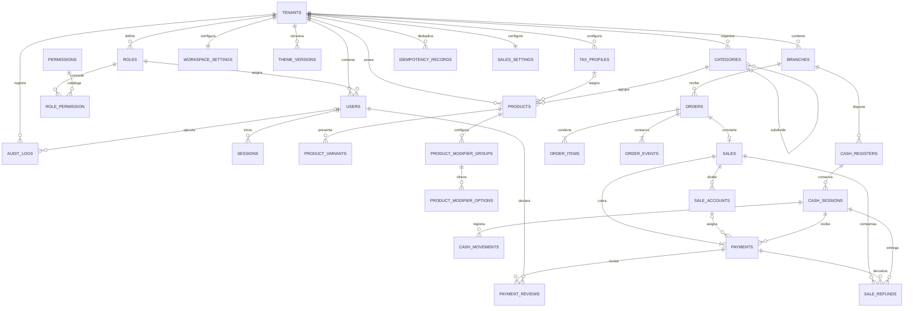

# Base de datos

## Precios por sucursal/canal (0.17)

Migración 000017: product_context_prices con tenant/product/variant/branch, canal all/takeaway/dine_in, amount DECIMAL(19,4), estado/revisión y marcas de tiempo. FK tenant/product/variant y tenant/branch; variant_scope/branch_scope STORED COALESCE(id,0) y unique compuesto evitan duplicados con null. Índices/scopes comprobados en SQLite 3.51.3 y MariaDB 10.4.32. order_items.price_snapshot JSON nullable conserva fuente/regla/revisión/importe/contexto, sin modificar líneas anteriores. Descenso rechazado para preservar historia; contrato en CONTEXT_PRICES.md.

## Modelo inicial implementado

La fuente ejecutable son las migraciones de `backend/database/migrations`. El [DDL MySQL](database/initial-schema.mysql.sql) se genera desde ellas con `php scripts/export-schema.php`, sin conectarse al servidor ni leer sus datos. No es un archivo `.mwb`; MySQL Workbench permite importarlo para construir y guardar el modelo EER.

| Tabla | Propósito y restricciones |
| --- | --- |
| tenants | Empresa, UUID público único, nombre, tipo, estado, moneda, zona e idioma. |
| users | Identidad global con correo único, password hash, tenant obligatorio, rol y estado. Índice único `(tenant_id,id)`. |
| roles | Nombre único por empresa, propietario protegido. Único `(tenant_id,id)` para claves compuestas. |
| permissions | Catálogo global de acciones implementadas, sin tenant; sembrado mediante DatabaseSeeder. |
| role_permission | Relación N:M con PK `(role_id,permission_id)`, tenant obligatorio y FK compuesta al rol. |
| branches | Empresa, código único por empresa, datos de contacto, estado activo. No se borran por API. |
| categories | Nombre único por empresa, descripción, color, estado y revisión. Único (tenant_id,id); parent_id nullable con FK tenant/parent e índice tenant/parent/name desde 0.15. Dos niveles validados bajo bloqueo de empresa; disponibilidad efectiva derivada, sin cascadas de flags. |
| products | Categoría con FK compuesta, SKU y barcode únicos por empresa (barcode nullable), precio/costo DECIMAL(19,4), estado, disponibilidad y revisión. |
| product_variants | FK compuesta (tenant_id,product_id) al producto; SKU y barcode únicos por empresa, nombre único por producto, precio/costo DECIMAL(19,4), estados y timestamps. |
| product_modifier_groups | Producto con FK tenant/product, nombre único por producto y tipo addon/exclusion estable; mínimo/máximo/estado/posición/revisión. Único tenant/product/id para referencias de opción; límite activo validado bajo bloqueo. |
| product_modifier_options | FK tenant/product/group al grupo correcto, nombre único por grupo y precio adicional DECIMAL(19,4), estado/posición. Archivo sin borrado y límite activo; cambios avanzan revisión de grupo/producto. |
| cash_registers | Sucursal con FK compuesta, código único por sucursal y active_session_id que referencia una sesión de esa misma caja mediante FK (tenant_id,id,active_session_id). |
| cash_sessions | Sucursal/caja/actores con referencias compuestas, moneda, importes DECIMAL(19,4), revisión, estado y fechas de apertura/cierre. Diferencia firmada nullable hasta cerrar. |
| cash_movements | Sesión/actor con FKs compuestas, tipo ingreso/egreso, importe positivo, motivo y fecha. Append-only por modelo y sin rutas de edición/borrado. |
| orders | UUID público, sucursal/actor, canal, referencia/notas, moneda, subtotal DECIMAL(19,4), estado/revisión y fechas. Sin vínculo a pago o caja todavía. |
| order_items | Pedido/producto/variante con FKs compuestas (incluye tenant/producto/variante), nombres/SKU/precio históricos, cantidad entera y subtotal/notas. tax_snapshot JSON; base_unit_price/modifiers_snapshot nullable desde 0.16, sin reinterpretar historia. Precio unitario/subtotal finales incluyen adicionales. Append-only. |
| order_events | Pedido/actor, estado anterior/nuevo, motivo y fecha; append-only. |
| idempotency_records | Clave UUID única por tenant, actor, acción, hash canónico de payload y recurso creado. Append-only, sin expiración automática. |
| sales_settings | Una fila por empresa, configured inicialmente false, impuesto adicional, revisión y secuencia. tip_enabled false y tip_tax_mode nullable hasta confirmación explícita included/excluded sobre su base. |
| sales | Únicos tenant/order y tenant/receipt_number; FK tenant/branch/order, actor, datos comerciales e importes DECIMAL(19,4) inmutables. Incluye ajustes/propina, calculation_version 1 (original), 2 (incluido global) o 3 (por producto) y tax_breakdown JSON inmutable. Solo estado/revisión mutables. |
| payment_methods | Código/nombre únicos por tenant, tipo cash/non_cash estable, estado/revisión y efectivo principal protegido; sin borrado. |
| payments | Varios pagos manuales por venta desde 0.7; FK a payment_methods y único (tenant,sale,id) para referencia histórica. Snapshot de método/procedencia/referencia. Sesión obligatoria; cash_movement_id nullable para no efectivo. Append-only. |
| payment_reviews | Declaraciones humanas append-only con versión única tenant/payment/version; FK tenant/sale/payment, tenant/branch/sale y tenant/actor. Neto esperado/observado/diferencia firmada DECIMAL(19,4), revisión financiera y snapshots de actor/moneda/referencia/motivo. No modifica importes operativos. |
| sale_refunds | Compensaciones parciales/completas por pago; FK (tenant,sale,payment_id), varias filas hasta el importe original desde 0.9. Índices tenant/sale y tenant/payment. Motivo/referencia/actor/sesión; cash_movement_id nullable. Append-only. |
| sale_accounts | Partes iguales de una venta desde 0.10: número/etiqueta/importe append-only, únicos tenant/sale/id y tenant/sale/number, FK tenant/sale. payments.account_id nullable con FK tenant/sale/account; obligatorio en servicio solo si hay división. Saldos derivados con BCMath, sin columnas editables de saldo. |
| tax_profiles | Nombre único por empresa, price_mode inclusive/exclusive, 1–5 rates JSON validados, is_active/revision y único tenant/id. Products.tax_profile_id nullable con FK tenant/profile. Sin borrado. Order_items.tax_snapshot copia perfil/tasas/revisión al crear pedido; Sales_settings.tip_tax_snapshot conserva política explícita de propina. JSONs no aceptados del cliente que cobra. |
| workspace_settings | Una fila por empresa, revisión entera, JSON de tema publicado. |
| theme_versions | Único `(tenant_id,version)`, schema_version y snapshot del tema, fecha. |
| audit_logs | Actor opcional, acción, descripción, IP, metadata y fecha. Índice `(tenant_id,created_at)`. |
| sessions | Sesiones Laravel en servidor, user_id indexado, payload cifrado, actividad. Es infraestructura central, no consultable por tenant a través de API. |
| password_reset_tokens | Token hasheado por correo y fecha, expira según broker Laravel. |
| cache / cache_locks | Caché central y bloqueo; hoy se usa para límites de acceso. |
| jobs / job_batches / failed_jobs | Infraestructura de colas Laravel; aún sin jobs de negocio. |

Desde 0.13, payments dispone además de índices (tenant,created_at,id) y (tenant,branch,created_at,id) para el historial. Sus acumulados se derivan por payment/refunds con BCMath; no se guardan saldos adicionales ni se usa SUM monetario de SQLite. El resumen es de página/moneda, no de todo un período.

Las FKs `(tenant_id,role_id) → roles(tenant_id,id)` en usuarios y pivot, y `(tenant_id,actor_id) → users(tenant_id,id)` en auditoría evitan referencias entre empresas incluso mediante escritura SQL directa. Todas restringen borrado. El tenant no es mass assignable en los modelos scoped. Fechas se serializan como ISO 8601 para renderizar según zona empresarial. El entorno usa America/Bogota; se debe unificar zona de las conexiones y revisar conversión temporal al desplegar MySQL.

Infraestructura `sessions.user_id` sigue el esquema Laravel con índice, sin FK: las sesiones se revocan explícitamente. No almacena `tenant_id`; la identidad de sesión resuelve la empresa en servidor. No hay borrado lógico todavía porque no se implementaron operaciones de borrado. Sucursales y usuarios tienen estado; los futuros catálogos con referencias históricas podrán usar soft deletes.

## MySQL Workbench

1. Regenerar desde la raíz: `php scripts/export-schema.php`.
2. En Workbench: **File → Import → Reverse Engineer MySQL Create Script**.
3. Elegir `docs/database/initial-schema.mysql.sql` y colocar los objetos importados en un diagrama EER.
4. Revisar claves compuestas y guardar el modelo como `.mwb` desde Workbench.

El script es para modelado en una base vacía. Para ejecutar Nexora, usar `php artisan migrate --seed`; importar el DDL manualmente no crea el historial de migraciones y provocaría colisiones al migrar. El exportador usa la gramática oficial MySQL de Laravel en modo pretend; **no equivale a una ejecución validada en MySQL**. La importación visual en Workbench queda pendiente de comprobar en su aplicación.

## Catálogo y operación implementados; resto de Fase 2 previsto

Ya existen catálogo, pedidos, caja, idempotencia y venta/devolución en efectivo con las restricciones descritas arriba. products incluye image_path e image_mime nullable para una fotografía privada. Los bytes viven en storage/app/catalog por empresa/producto, sin enlaces públicos. Las ampliaciones siguientes **son diseño pendiente**. Sus tablas operativas llevarán tenant_id, índices de empresa y FKs compuestas.

Los SKU y barcode tienen índices únicos por tabla/empresa. La unicidad adicional entre productos y variantes se asegura en servicios mediante comprobaciones bajo el mismo bloqueo de fila de empresa; no existe una restricción SQL que cruce ambas tablas. No realizar escrituras directas de códigos evitando estos servicios. Las variantes no tienen una revisión independiente: toda modificación incrementa products.revision dentro de la transacción.

- Catálogo: categories con parent_id del mismo tenant; products N:1 categoría; product_variants N:1 producto; product_images; branch_prices único por variante/sucursal/canal; product_modifiers y modifier_options.
- Salones: dining_rooms N:1 sucursal; dining_tables N:1 salón, nombre, forma, capacidad, posición/tamaño/rotación; floor_plan_versions JSON validado para decoración y geometría; table_groups/table_group_members para uniones temporales.
- Pedidos: ampliar orders con cliente enlazado; order_tables N:M mesas; snapshots de impuestos en detalle, order_item_modifiers y order_transfers para movimientos auditados. El historial básico ya existe como order_events.
- Caja: ampliar conciliación y expenses con autorización. Caja/sesiones, movimientos manuales, métodos configurables y vínculos a pagos ya existen. Los no efectivos no crean movimiento de efectivo.
- Venta: división en partes iguales/pagos por cuenta desde 0.10; división por productos y unión/traslado de pedidos pendientes. Detalles conservados en order_items inmutables. Abonos/mixtos admiten varios payments desde 0.7; devoluciones parciales por payment desde 0.9 conservan FK y límites acumulados, sin unicidad por pago. invoice_series, invoices e invoice_lines separados del recibo interno.
- Clientes y reservas: customers; customer_addresses; reservations y reservation_tables; dirección de venta como snapshot.

Dinero `DECIMAL(19,4)` y BCMath; cantidades de pedido actuales enteras, las fracciones de inventario usarán `DECIMAL(19,6)`; no floats financieros. Venta en efectivo cobra dos decimales half-up, conservando ajuste frente al catálogo; detalles en SALES.md. Índices compuestos `(tenant_id,branch_id,created_at)`, estados y claves de idempotencia. Ninguna devolución elimina una venta o pago histórico. Estado de caja bloqueado al confirmar movimientos, sumas controladas en transacción. SQLite NUMERIC puede redondear importes extremos; las garantías monetarias se verifican sobre MariaDB y la validación específica de MySQL 8 permanece pendiente.

## Modelo previsto: gestión avanzada

Ingredientes y productos terminados comparten stock_items, units y unit_conversions controladas. inventories por sucursal/almacén, stock_batches con vencimiento, stock_movements/kardex y stock_counts/stock_count_lines. recipes/recipe_versions/recipe_lines permiten ingredientes y subrecetas con prevención de ciclos. sale_consumptions conserva el vínculo venta-receta-lote y cantidades utilizadas.

Suppliers → purchase_orders → purchase_order_lines → goods_receipts/receipt_lines generan movimientos; supplier_payables/payable_payments gestionan cuentas. Transferencias: stock_transfers y transfer_lines, estados de despacho/recepción. Waste_records enlaza desperdicios con movimiento y motivo.

Kitchen_stations, product_station_routes, kitchen_tickets/ticket_items y preparation_events derivan de pedidos; canales Reverb privados por empresa y sucursal. Employees enlaza users opcionalmente con branch_assignments N:M; shifts, attendance y commission_rules. No todo empleado debe tener una cuenta de acceso.

## Modelo previsto: Studio y SaaS

Themes, ui_layouts/ui_layout_versions por rol/dispositivo, component_definitions, print_templates/print_template_versions, custom_field_definitions/custom_field_values y automation_rules/automation_runs. Reglas con condiciones/acciones tipadas, sin scripts de usuario. Adaptar el tema inicial mediante migración de schema_version.

Plans, plan_prices con moneda/vigencia, modules, plan_module, subscriptions, subscription_events y usage_counters. Los precios iniciales propuestos (49.900 / 99.900 / 199.900 COP) son requisitos provisionales de Fase 5; no están sembrados ni facturados hoy. Soporte: support_requests; anuncios: platform_notices; acceso SaaS: admin_access_grants y admin_audit_logs en dominio separado de la auditoría del restaurante.

Fidelización: loyalty_accounts/transactions, coupons/redemptions, customer_memberships. Delivery: delivery_zones, delivery_rates, deliveries, delivery_status_events y courier_assignments. Menú QR: public_menus, menu_publications y table_qr_tokens limitados/revocables. Notificaciones: notifications y delivery_attempts. Offline: devices, sync_operations, outbox_events, inbox_receipts y conflict_records con claves de deduplicación.

## Evolución y operaciones

Antes de incorporar una tabla: definir dominio, retención, tenant, sucursal, relaciones, índices y autorización. Migraciones incrementales con estrategia expand/contract para cambios incompatibles; no editar migraciones ya publicadas. Backups cifrados y restauraciones de prueba antes de migraciones productivas. Este entorno inicial aún no tiene servicio de backups o réplica configurado.
